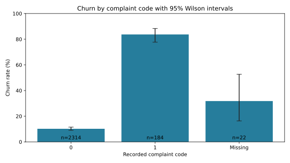

# Customer Churn Segments

A Python exploratory analysis of customer churn across recorded complaint, tariff and charge codes. The workflow produces segment counts, churn rates and uncertainty intervals for retention analysis.

## Features

- Calculates overall churn and segment-level rates with explicit denominators.
- Preserves missing segment values as a separate category.
- Reports 95% Wilson score intervals for each proportion.
- Validates unique customer identifiers, required columns and category codes.
- Exports aggregate CSV and JSON results and an SVG comparison chart.
- Includes a fictional runnable example and six unit tests.

## Results

The supplied sample contains **2,520 customers**, including **397 labeled as churned (15.75%)**.

| Recorded complaint code | Customers | Churned | Churn rate |
|---|---:|---:|---:|
| 0 | 2,314 | 236 | 10.20% |
| 1 | 184 | 154 | 83.70% |
| Missing | 22 | 7 | 31.82% |



The results describe associations in the supplied labeled sample. They do not establish that complaints cause churn or demonstrate predictive performance. Codes retain their input meanings; tariff codes are not assigned unverified plan names. Wilson intervals assume independent binary observations and do not account for selection bias. Small groups should be interpreted cautiously.

## Run

Requires Python 3.10 or later.

```bash
python -m pip install -r requirements.txt
python analyze.py examples/demo.csv --output demo-results
python -m unittest -v
```

The demo contains fictional customer records. To analyze a local dataset:

```bash
python analyze.py data/Kaggle_churn_training.csv --output results
```

The source customer records are not bundled. Published results contain aggregate summaries only.

## Input

| Column | Accepted values |
|---|---|
| `Customer_ID` | Unique, nonempty identifier |
| `Churn` | 0 or 1; 1 indicates churn; no missing values |
| `Complains` | 0, 1 or missing |
| `Tariff_Plan` | 1, 2 or missing |
| `Charge_Amount` | Integer codes 0 through 10 or missing |

Extra columns are ignored. Each segmentation includes every customer exactly once. Rates divide churned customers by all customers in that category. Missing values are not imputed. Charge codes are treated as categories, not monetary amounts.

## Outputs

- `results/segment_rates.csv`: group counts, churn rates and interval bounds.
- `results/summary.json`: overall counts and missing-value totals.
- `results/complaint_churn.svg`: complaint-code comparison with interval bars.
- `results/verification.txt`: unit-test and independent verification record.

The source sample has 22 missing complaint codes, 29 missing tariff codes and 258 missing charge codes. Independent checks reproduce all group counts and rates; interval bounds also match SciPy's Wilson implementation.
